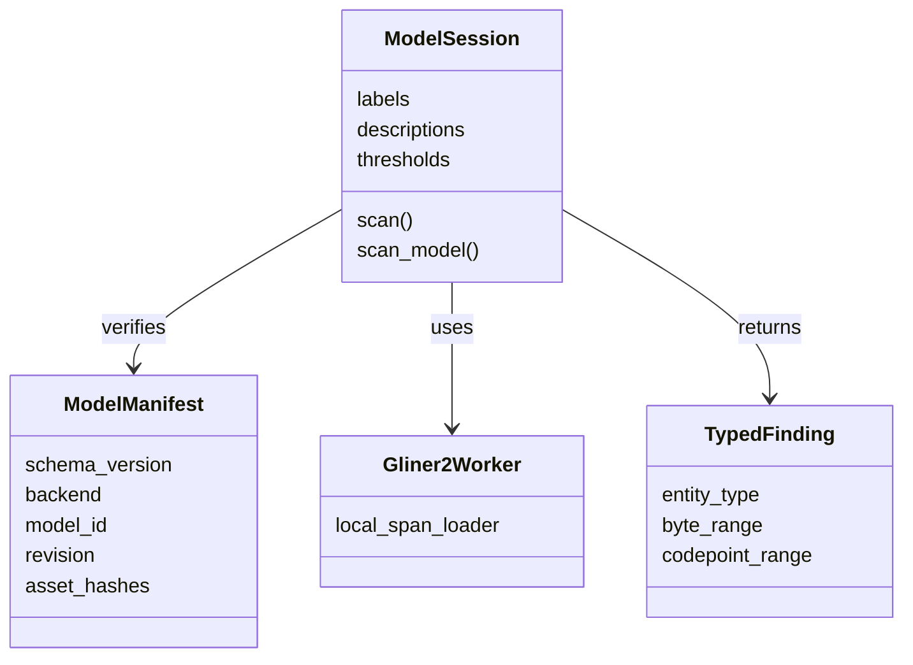

# Model manifests and configurable GLiNER2 entities

## Contract

Compatible GLiNER2 span models and entity schemas can be selected through local
configuration without editing Core for each model or label. The acceptance
criteria are correct loading, schema forwarding, model identity, typed findings,
offsets, transformation compatibility and failure behavior. Model accuracy,
recall, calibration and comparative benchmarks are outside this change.

Available from `0.4.5-beta.4` (Python `0.4.5b4`). No new runtime dependencies are required.

## A shared format, one manifest per model

The envelope below describes the local assets and model identity. Values in
angle brackets are placeholders, not a usable model release. Replace each digest
and byte size with the selected, downloaded file's actual identity. The `files`
object must include every asset loaded by the model; include licenses/notices too.

For ordinary model swaps, the provisioner generates this file and its hashes
from local assets with `--model-id` and `--revision`; callers do not edit hashes
by hand. `--manifest` is the alternative for verifying an existing asset pin.

```json
{
  "schema_version": 1,
  "model": {
    "backend": "gliner2",
    "id": "fastino/gliner2-base-v1",
    "revision": "<exact model revision selected by the operator>"
  },
  "platform": "portable-cpu",
  "files": {
    "config.json": {"sha256": "<sha256>", "bytes": 0},
    "encoder_config/config.json": {"sha256": "<sha256>", "bytes": 0},
    "tokenizer.json": {"sha256": "<sha256>", "bytes": 0},
    "tokenizer_config.json": {"sha256": "<sha256>", "bytes": 0},
    "model.safetensors": {"sha256": "<sha256>", "bytes": 0}
  }
}
```

The JSON number sizes above are placeholders, not expected sizes or limits.
Downloading remains explicit. The provisioner copies and verifies the listed
files, writes `bundle-manifest.json`, and emits its SHA-256. Session configuration
continues to contain `bundle`, `manifest_sha256`, `limits` and `gliner2`.
Core verifies that caller-selected manifest digest and the listed asset hashes
before opening the worker. There is no hosted fallback or automatic download.

The provisioner trusts the manifest chosen by its caller. A digest detects a
different file; it is not a publisher signature or an authenticity guarantee.

The format is shared by the existing bundle parser. `gliner2` selects the
existing GLiNER2 loader. The existing native DataFog loader accepts the same
identity envelope with backend `datafog_native`, id `DataFog/pii-en-65m`, and
the published `MODEL_REVISION`; its current native protocol, calibration and
asset qualification remain in force. GLiNER1 and spaCy have no Core loaders on
this base commit. A manifest for those backends must fail rather than pretend
they are implemented. Generalizing their loaders is a separate change.

## Labels describe the session task

The model manifest does not impose a universal list of labels. A general model
may be reused for different callers by supplying different session schemas:

```json
"labels": [
  {
    "label": "current_employer",
    "description": "The organization the caller currently works for",
    "threshold": 0.5
  }
]
```

The threshold is an example caller choice, not a calibrated probability or a
new default. This release retains existing threshold handling. Labels and their
descriptions already reach the official worker through `create_schema().entities`.
Schemas remain fixed for the lifetime of a session. Sessions do not support
per-turn schema mutation or reload the model for every scan.

Output names remain uppercase with the existing `phone_number` to `PHONE` alias.
Labels producing the same output type are rejected, since a typed response could
not distinguish them. Unknown model-returned labels, malformed spans and invalid
scores remain errors. GLiNER2 raw scores stay separate from calibrated confidence.
The existing rules/model routing and `scan_model`/`scanModel` APIs are unchanged:
rule-covered types still route to rules in `scan`, while custom types route to
the model. `scan_model` exercises the model even for shared types.

## Architecture



## Validation

The release workflow exercises the original pinned PII bundle and a versioned
`fastino/gliner2-base-v1` bundle with a custom `current_employer` label and
description. It checks packaged Rust and installed Python/Node behavior,
identity, typed findings, Unicode offsets, routing, cancellation and cleanup.
Empty results remain valid; these checks do not grade model accuracy.
Deterministic tests also verify nonempty custom spans and redaction, invalid
manifest identities, duplicate output types, unsafe paths and asset mismatches.

## Scope boundary

Supporting a common manifest format does not make every model interchangeable.
The adapter still determines the loading API, file layout and runtime protocol.
The existing worker supports GLiNER2 span models through its pinned CPU runtime;
changing architectures or adding GLiNER1/spaCy workers requires separate adapter
work. No accuracy threshold, performance target, model catalog, remote registry,
new resource quota or new third-party dependency is introduced here.
